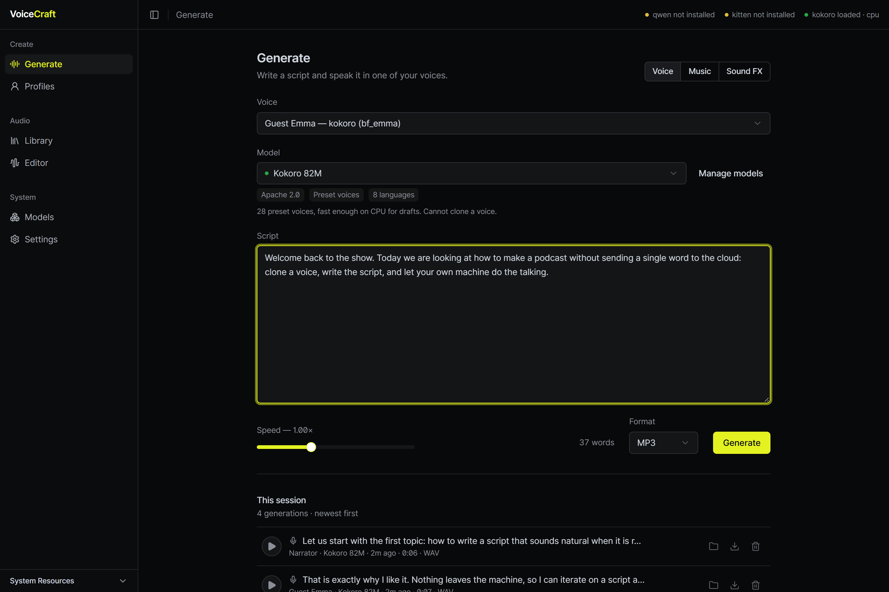
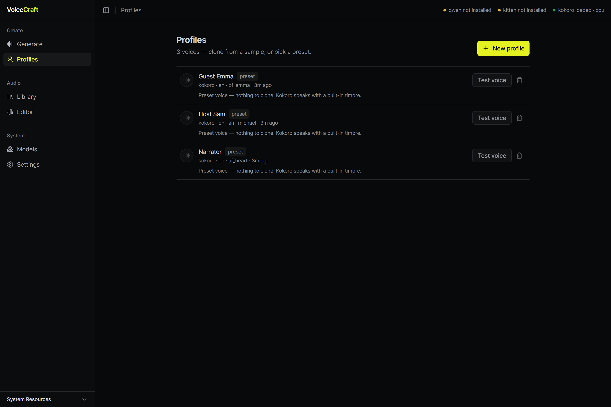
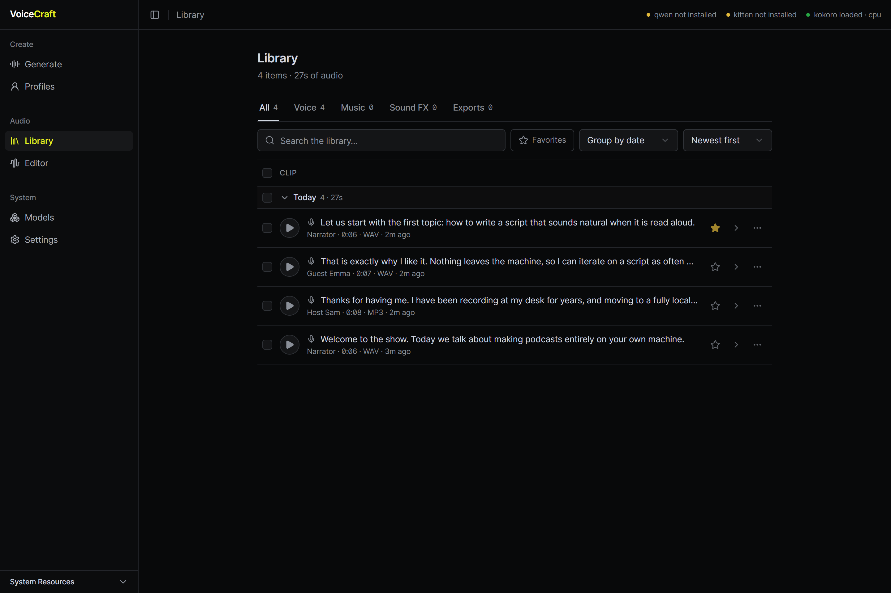
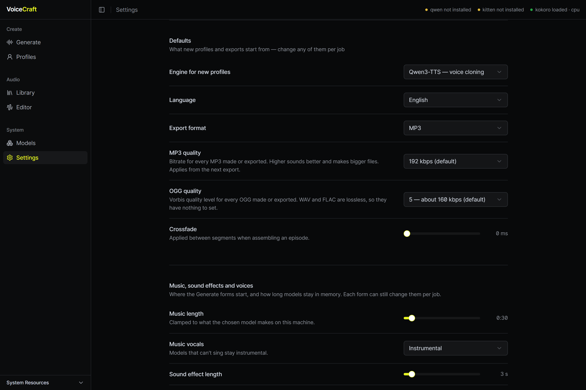

# VoiceCraft

Local-first voice cloning, music and sound effects, plus podcast assembly.
Clone a voice, generate speech from a script, make a music bed or a sound
effect from a text description, then arrange it all on a multitrack timeline
and export. Everything runs on your own machine. The only network traffic is
the setup download and the models you choose to download.

```
app/         React + TypeScript + Tailwind (Vite): Profiles, Generate, Library, Editor, Models, Settings
src-tauri/   Tauri (Rust) desktop shell, launches the backend as a child process
backend/     FastAPI + SQLite + ffmpeg  (see backend/README.md)
```

## Features

- **Voice cloning and text to speech** with Qwen3-TTS and KittenTTS 2, plus
  Kokoro's preset voices for fast drafts on a CPU.
- **Music** from a style description, instrumental or with lyrics (ACE-Step 1.5,
  Stable Audio 3).
- **Sound effects and ambiences** from a text description (MOSS-SoundEffect v2,
  Stable Audio 3 Small).
- **Start from an existing clip**: make a variation of it, extend it, or
  regenerate one part and keep the rest.
- **Library** with search, filters, grouping, favourites and bulk export.
- **Multitrack editor** with fades, crossfades, ducking, effects, silence
  removal, loudness analysis and export.
- **Models page** to download, choose and remove model weights, with each
  model's licence shown before you download it.
- Output as **WAV, MP3, OGG or FLAC**.

## Screenshots



| | |
|---|---|
|  |  |
| **Profiles**: clone a voice or pick a preset | **Library**: search, filter and export everything you made |



## Download

[](https://github.com/schuettla/VoiceCraft/releases/latest)

**[Download the latest version](https://github.com/schuettla/VoiceCraft/releases/latest)**
(always the newest release; pick the file for your system under **Assets**).

| System | Download | Notes |
|---|---|---|
| **Windows 10/11 (64-bit)** | `VoiceCraft_<version>_x64-setup.exe` | Installer. |
| | `VoiceCraft_v<version>_x64-portable.exe` | Single file, no install. Just run it. |
| **macOS (Apple Silicon)** | `VoiceCraft_<version>_aarch64.dmg` | Intel Macs are not supported. |
| **Linux (x86_64)** | `VoiceCraft_<version>_amd64.AppImage` | |

Not sure which one? Windows: the `setup.exe`. Mac: the `.dmg`. Linux: the
`.AppImage`. Ignore the `.app.tar.gz` file; it is only an internal build artifact.

**Staying up to date.** VoiceCraft checks GitHub for a newer release when it
starts (at most once a day) and shows a notice with a **Download** button. It
never downloads or installs anything by itself. You can turn the check off or run
it by hand under **Settings → Updates**. To update, download the newest file from
the link above and install it over the old one; your voices, library and models
are kept.

## Install and run

The apps are unsigned, so your OS warns once on first launch:

- **Windows**: SmartScreen shows a warning. Click **More info → Run anyway**.
- **Linux (AppImage)**: `chmod +x VoiceCraft_*.AppImage`, then run it. On
  Ubuntu 22.04+ you may need `sudo apt install libfuse2` first.
- **macOS**: open the `.dmg` and drag VoiceCraft into Applications. The app isn't
  notarized, so Gatekeeper blocks the first launch. On macOS 15+, right-click →
  Open no longer works. Go to **System Settings → Privacy & Security → "Open
  Anyway"** instead, or run `xattr -cr /Applications/VoiceCraft.app` in Terminal.

You don't need to install Python, open a terminal or have admin rights. On first
launch the app shows a setup screen that:

1. detects your GPU (CUDA on NVIDIA, Metal on Apple Silicon, CPU otherwise),
2. downloads a **private Python 3.12** and ffmpeg if they aren't already
   present (nothing is installed system-wide),
3. creates a runtime environment in the app's data folder,
4. installs PyTorch (the right build for your GPU) and the speech engines
   (Qwen3-TTS, KittenTTS, Kokoro), streaming progress into the window,
5. downloads the Kokoro voice model,
6. starts the backend and opens the studio.

Re-run setup any time from **Engine setup** in the sidebar (or **Settings →
Re-run setup**), for example after changing your GPU. If a new version of the
app needs a newer runtime, the setup screen offers to rebuild it. Your voices,
library and downloaded models are not touched.

Music and sound-effect engines are not part of first-run setup. You install each
one from the **Models** page when you want it (see "Music and sound effects"
below).

## Making an episode

1. **Profiles**: create a voice.
   - **Qwen3-TTS**: upload a 10–30 s reference clip. Add the clip's transcript
     too; the clone is noticeably closer with it.
   - **KittenTTS 2**: either clone (a 5–30 s clip plus its transcript, which is
     required) or pick one of its 115 preset voices.
   - **Kokoro**: pick a preset voice. Kokoro can't clone, but it is fast on a CPU.

   Creating a cloned profile runs the clip through the model once and stores the
   resulting voice print, so every later generation reuses it. **Test voice**
   speaks a line so you can judge the result before writing a script.
2. **Generate**: pick the voice, paste the script and choose the output format.
   The **Model** list shows the models of that voice's engine and what each one
   still needs, if anything. For KittenTTS 2 you can also choose a **Stable** or
   **Expressive** style, set a seed, and use tags such as `[joyful]`,
   `<laugh>` or `(((word)))` for emphasis. Jobs queue and run one at a time;
   their status survives a restart.
3. **Library**: every generation and export in one place:
   - tabs for Voice, Music, Sound FX and Exports;
   - search across scripts, prompts and lyrics;
   - filters by status, voice and favourites;
   - grouping by date, type, voice, engine, length or format, and several sort
     orders;
   - select several items to export, favourite or delete them together;
   - **Show details** shows the settings a clip was made with;
   - **Use voice & script** sends a speech clip back to Generate, and **Edit
     clip…** starts a new music or sound-effect clip from an existing one.

   Exports are new files; the original is never touched.
4. **Editor**: a multitrack timeline.
   - **Media bin**: voice, music and sound-effect clips, filterable by type, next
     to imported audio and intro/outro slots.
   - **Editing**: drag clips onto tracks, trim, split with the razor tool, fade,
     crossfade and snap. Ripple-delete or gap a range, add markers, undo and redo.
   - **Tracks**: mute and solo, and duck one track under another (a music bed
     under a voice).
   - **Effects** per clip, track and master: EQ, compression, limiting, gate,
     noise and hum removal, de-click, reverb, echo, pitch, tempo and more. Freeze
     a clip's effects into a new asset when you like the result.
   - **Silence removal** and a **loudness report**, then export with loudness
     normalisation to a LUFS target.
5. The finished file lands in the app data folder's `edits/` directory.

Every edit writes a new file; sources are never overwritten.

## Music and sound effects

The **Generate** page switches between **Voice**, **Music** and **Sound FX**.
Each mode has a **Model** list at the top. It shows every model of that kind,
ready ones first, with what the others still need: the engine installed, the
model downloaded, or a GPU this machine doesn't have. When a model isn't ready
yet, the page shows a card that says what is missing and links to the Models
page.

- **Music**: a style description (genre, instruments, mood, tempo), either
  instrumental or with lyrics, a length, and an optional seed, step count and
  guidance.
- **Sound FX**: a description, a length of up to 30 s, and 1–4 takes (variations
  made one after another).
- **Start from a clip**: the wand button on a finished music or sound-effect clip
  (or **Edit clip…** in the Library) starts a new one from it:
  - **Variation**: a new take that stays close to the clip, with a slider for how
    much may change.
  - **Extend**: keeps the clip and continues it.
  - **Replace a part**: regenerates the section you mark and keeps the rest.

  Stable Audio 3 is the engine that can do this.
- Default lengths, takes and vocals are set in **Settings**.

| Engine | Makes | Hardware |
|---|---|---|
| **ACE-Step 1.5** | music, instrumental or with lyrics | NVIDIA GPU with about 6 GB of VRAM or more. On cards under 8 GB, or older than the RTX 30 series, clips are limited to 30 s. |
| **MOSS-SoundEffect v2** | sound effects and ambiences | NVIDIA GPU. On small cards it runs with offloading and takes minutes per clip. |
| **Stable Audio 3 Small** | music (up to 2 min) and sound effects, instrumental only | Runs on a CPU or a small GPU, so a PC without NVIDIA gets this one. |
| **Stable Audio 3 Medium** | music (up to 6 min 20 s), instrumental only | NVIDIA RTX 30 series or newer. |

Music and sound effects are not supported on macOS yet.

To start, open **Models → Music generation** (or **Sound effects**), click
**Install engine**, then **Download** a model. Installing adds the engine's
Python packages to the app's runtime and restarts the backend. Stable Audio 3 is
one package for both lists, so installing or removing it applies to both.
Removing a model also removes the files the app prepared for it.

**Gated models (Stable Audio 3).** Hugging Face only serves these to an account
that has accepted the model's terms. To set this up once:
1. Sign in at huggingface.co, open each model's page and accept its terms.
2. Create a **read** token at huggingface.co/settings/tokens.
3. Paste it under **Models → Hugging Face access** (or on the install card in
   Generate).

VoiceCraft uses the token only for those downloads, keeps it in its own data
folder (`secrets/hf_token`) and never shows it again. If you haven't pasted one,
a token from your own Hugging Face login (`HF_TOKEN`, `huggingface-cli login`) is
used. The download also fetches the model's text encoder (a second repository,
about 1.2 GB), which may have its own terms. If Hugging Face refuses it, the
message names the repository.

The app data folder is `%LOCALAPPDATA%\VoiceCraft` on Windows,
`~/Library/Application Support/VoiceCraft` on macOS, and
`~/.local/share/VoiceCraft` (or `$XDG_DATA_HOME`) on Linux.

## Models

The **Models** page is where weights are downloaded, removed and chosen:

| Model | Use | Size | License |
|---|---|---|---|
| Qwen3-TTS 0.6B (Base) | speech, cloning; the default, fits a 6 GB card | ~2.2 GB | Apache 2.0 |
| Qwen3-TTS 1.7B (Base) | speech, cloning; wants 8 GB of VRAM | ~5.4 GB | Apache 2.0 |
| Kokoro 82M | speech, 28 preset voices, runs on CPU | ~0.4 GB | Apache 2.0 |
| KittenTTS 2 | speech, cloning and 115 preset voices; GPU strongly advised | ~1.1 GB + a ~1 GB vocoder file | Stellon Labs Community License |
| KittenTTS 2 (small) | the same, smaller weights | ~0.6 GB + the vocoder file | Stellon Labs Community License |
| ACE-Step 1.5 (turbo) | music, the default | ~10.8 GB | MIT |
| ACE-Step 1.5 (quality) | music, slower, aimed at quality | ~5.1 GB, plus ~1.5 GB it shares with turbo | MIT |
| ACE-Step 1.5 (base) | music, the untuned foundation model, 50 steps | ~5.1 GB, plus ~1.5 GB it shares with turbo | MIT |
| ACE-Step 1.5 XL (turbo) | music, larger model | ~21.4 GB | MIT |
| ACE-Step 1.5 XL (quality) | music, larger model, quality fine-tune | ~21.4 GB | MIT |
| ACE-Step 1.5 XL (base) | music, larger untuned foundation model | ~21.4 GB | MIT |
| MOSS-SoundEffect v2 | sound effects and ambiences, up to 30 s | ~12.1 GB | Apache 2.0 |
| Stable Audio 3 Small (music) | lite music, CPU or small GPU, up to 2 min, instrumental, gated | ~2.3 GB + ~1.2 GB text encoder | Stability AI Community License |
| Stable Audio 3 Medium (music) | larger music model, up to 6 min 20 s, instrumental, gated; RTX 30 series or newer | ~8 GB + ~1.2 GB text encoder | Stability AI Community License |
| Stable Audio 3 Small (sound effects) | lite sound effects, CPU or small GPU, gated | ~2.3 GB + ~1.2 GB text encoder | Stability AI Community License |

Sizes are approximate; the Models page shows the real figure once a model is on
disk. A model that needs a newer GPU than yours is still listed, with the
reason, but can't be downloaded or chosen.

**Which model is used.** **Use this model** on the Models page sets each
engine's active model, and the Generate page starts from it. Picking another
model in Generate's **Model** list uses that one for the job, which then becomes
the active one. The choice is stored in `settings.json` in the app data folder.
`VOICECRAFT_QWEN_MODEL` / `VOICECRAFT_KOKORO_MODEL` override it if set.

**Where weights live.** Weights are kept in the **Hugging Face hub cache**, not
the app data folder, so they are shared with every other Hugging Face tool on
the machine. **Change** points the app at a different cache (useful when `C:` is
full) and copies nothing: models already in the new folder show up immediately,
and models left in the old one show as not downloaded. **Reset** goes back to
the Hugging Face default (`~/.cache/huggingface/hub`, or whatever `HF_HOME` /
`HF_HUB_CACHE` say).

### Licences

VoiceCraft ships no model weights. Each model is downloaded from its authors'
repository, and its licence is between you and them. The Models page shows every
entry's licence tier and links to its terms, and **Settings → About** lists the
credits. Some licences restrict commercial use of what you make, so read them
before using output in monetised work.

**KittenTTS 2: Powered by KittenML.** Its weights are under the
[Stellon Labs Community License](https://huggingface.co/KittenML/kitten-tts-2/blob/main/LICENSE.md):
free for personal use, with commercial use subject to the licence's terms
(including a revenue limit).

**Stable Audio 3: Powered by Stability AI.** Its weights are under the
[Stability AI Community License](https://stability.ai/license): free for personal
use and for organisations below $1M annual revenue; larger ones need a licence
from Stability. The `stable-audio-3` code the app installs is MIT.

## Settings

The **Settings** page has:
- **Hardware**: the GPU and precision the engines use, VRAM in use and a **Free
  VRAM** button.
- **Defaults**: for new profiles and exports.
- **Music, sound effects and voices**: default music length and vocals, sound
  effect length and takes, the KittenTTS 2 style, and how long models stay
  loaded when the app is idle (0 keeps them loaded).
- **Storage**: the ffmpeg binaries in use, and the data folder broken down by
  kind with **Reclaim space**, which deletes scratch files and orphans, never
  anything the app still lists.
- **Updates**: the version you run, a **Check now** button, and a switch for the
  check at startup.
- **About**: credits for the model authors, with links to their licences.

The backend listens on **127.0.0.1:17610**. `VOICECRAFT_PORT` overrides it
(change `app/src/lib/api.ts`, `src-tauri/src/backend.rs` and the CSP in
`tauri.conf.json` to match).

## Requirements

- Windows 10 1803+ or Windows 11; a modern x86_64 Linux desktop (AppImage); or
  macOS 11+ on Apple Silicon (Intel Macs are not supported).
- **GPU**:
  - **Speech**: an NVIDIA GPU is optional. CPU works but is slow, and the app
    says so. Apple Silicon gets Metal (MPS) acceleration automatically.
  - **Music and sound effects**: ACE-Step and MOSS need an NVIDIA GPU.
    Stable Audio 3 Small runs without one.
- **Disk**: the shared runtime takes a few GB. Each model adds its own download,
  from ~0.4 GB for Kokoro up to ~21 GB for ACE-Step XL.
- Nothing else: the app installs Python and ffmpeg itself.

## Developing

You need Python 3.12, Node 20+, Rust (stable), the
[Tauri prerequisites](https://v2.tauri.app/start/prerequisites/) for your OS
(Windows: MSVC build tools + WebView2; Linux: `libwebkit2gtk-4.1-dev`,
`libappindicator3-dev`, `librsvg2-dev`, `patchelf`; macOS: Xcode command line
tools), and `ffmpeg` / `ffprobe` on `PATH` to run the backend directly.

```powershell
# 1. backend deps (see backend/README.md for the platform-specific torch command first)
py -3.12 -m venv .venv
.venv\Scripts\python.exe -m pip install -r backend\requirements.txt

# 2. frontend + Tauri CLI
npm install
npm --prefix app install

# 3. run the whole app (Tauri starts the backend itself)
npm run dev
```

macOS / Linux equivalents for step 1:

```bash
python3.12 -m venv .venv
.venv/bin/python -m pip install -r backend/requirements.txt
```

Backend or frontend alone:

```powershell
npm run backend:dev    # http://127.0.0.1:17610/docs
npm run app:dev        # http://localhost:5173
npm run backend:test   # ffmpeg-backed smoke test, no models needed
```

The other backend test suites run the same way and need no models or GPU:
`python backend/tests/test_<name>.py` (`plumbing`, `audio`, `sa3`, `kitten`,
`timeline`).

`npm run dev` starts the Python backend with `.venv\Scripts\python.exe`
(`.venv/bin/python` on macOS/Linux), or `python` if there is no venv. To attach
your own backend instead:

```powershell
$env:VOICECRAFT_BACKEND_CMD = "none"   # Tauri won't spawn one
```

(`export VOICECRAFT_BACKEND_CMD=none` on macOS/Linux.)

## License

VoiceCraft is MIT-licensed (see [LICENSE](LICENSE)). Model weights are not part
of the project and keep their own licences (see [Licences](#licences)).
